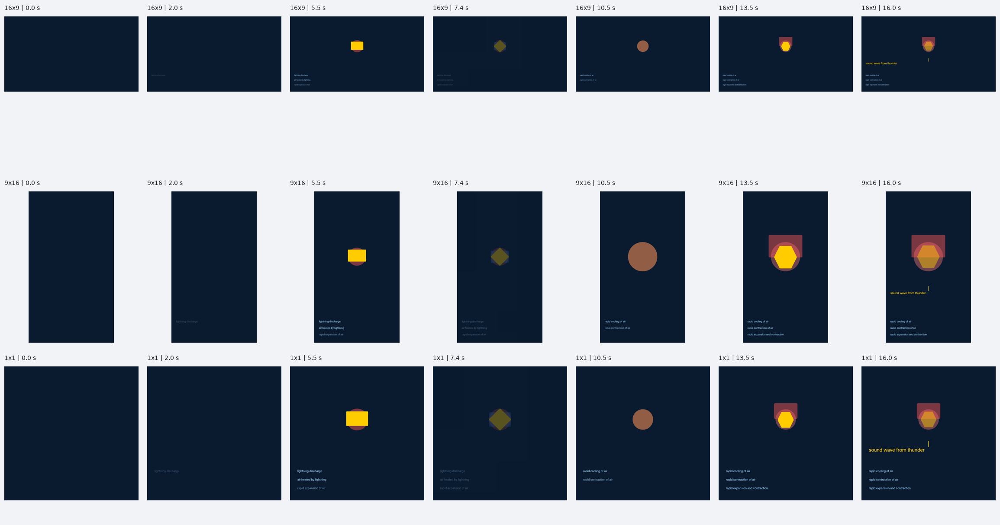

# Independent explainer system: scope, checkpoint and roadmap

**Checkpoint date:** 12 October 2026

**Product state:** experimental execution foundation; not an accepted explainer producer

**Current outcome-based assessment:** 25/100

**Authority:** `DEVELOPMENT_PREFLIGHT`; no Creative Lock or production certification

**Public dispatch:** disabled for this independent route
**Purpose of this checkpoint:** preserve the actual code, actual failed output and the remaining implementation contract, not declare the task finished.

## Contents

1. [Executive verdict](#1-executive-verdict)
2. [Overall task and scope](#2-overall-task-and-scope)
3. [What a successful film must do](#3-what-a-successful-film-must-do)
4. [Architecture and ownership](#4-architecture-and-ownership)
5. [Verified progress](#5-verified-progress)
6. [Actual proof and its limitations](#6-actual-proof-and-its-limitations)
7. [Diagnosis of the failed approach](#7-diagnosis-of-the-failed-approach)
8. [Required production language](#8-required-production-language)
9. [Non-templated direction and coherent style](#9-non-templated-direction-and-coherent-style)
10. [Native three-format composition](#10-native-three-format-composition)
11. [Motion, visibility and continuity](#11-motion-visibility-and-continuity)
12. [Narration, sound and timing](#12-narration-sound-and-timing)
13. [Factuality, rights and governance](#13-factuality-rights-and-governance)
14. [Quality assurance and acceptance](#14-quality-assurance-and-acceptance)
15. [Performance and operational robustness](#15-performance-and-operational-robustness)
16. [Ordered implementation roadmap](#16-ordered-implementation-roadmap)
17. [Testing strategy and generalization](#17-testing-strategy-and-generalization)
18. [Integration and release plan](#18-integration-and-release-plan)
19. [Checkpoint contents and recovery](#19-checkpoint-contents-and-recovery)
20. [Definition of done and immediate next work](#20-definition-of-done-and-immediate-next-work)

---

## 1. Executive verdict

The task is to build a **general-purpose automated director-to-performance system for rich explainers**, not to decorate kinetic text, place labelled shapes on coloured backgrounds, or reproduce a fixed catalogue of scenes from one reference.

The system should turn a brief, audience context and reliable evidence into a film that makes relationships and changes understandable through coordinated imagery, composition, motion, narration and sound. It must perform that explanation natively in landscape, portrait and square.

There is substantial executable infrastructure now: a typed meaning graph, compact direction contract, deterministic lowering, three-format compilation, motion runtime, measured Liam narration, rendering, technical audits and an internal authority adapter. A real short film has been generated in all three formats.

**The product objective has not been achieved.** The real film is visually weak and sometimes misleading. It starts with an empty composition, uses generic primitives, detaches labels from objects, collapses actors through shared focus movement, and names a physical process without demonstrating it. Original narration, consistently good directing, rich imagery, sound direction, efficient turnaround and reliable cross-topic quality are not established.

The current 25/100 assessment prioritizes the requested output over implementation volume:

| Area | Earned / available | Basis |
|---|---:|---|
| Explanatory visuals and polish | 5/35 | The actual film does not demonstrate its mechanism or approach the requested finish. |
| Automatic authoring reliability | 3/20 | Repeated invalid drafts; the successful render used explicit source quotation. |
| Native composition and motion | 4/15 | Independent layouts exist, but motion damages their relationships. |
| Factual grounding | 5/10 | Source sentences are preserved; a misleading display label still passes. |
| Rendering and audio mechanics | 7/10 | Three actual encoded videos with intelligible Liam narration. |
| Turnaround and production readiness | 1/10 | Slow repair cycles and no demonstrated reliable delivery workflow. |
| **Total** | **25/100** | Evidence-based engineering judgment, not a standardized benchmark. |

This rating is for the **new independent explainer route**, not all of NexStudio. It is not a percentage-complete calculation, a test-suite score, or a certification.

## 2. Overall task and scope

### 2.1 Intended input and output

Inputs should include:

- A precise brief: what the audience should understand, not merely a topic.
- Audience knowledge, tone, language, delivery context and duration preference.
- Source evidence with claims, locators, uncertainty and commercial-use rights.
- Brand constraints, selected shade-family direction and any protected colours.
- Available, licensed assets and declared execution capabilities.
- Relevant film/series history, including deliberate motifs and recent structural repetition.
- Voice selection and available licensed sound material.

Outputs should include:

- A source-bound explanatory argument and selected visual strategy.
- A complete directed score, with narration and executable state progression.
- Separate native plans for 16:9, 9:16 and 1:1.
- Actual encoded films with the exact measured narration and directed audio.
- Evidence, asset, timing, execution and review manifests.
- A truthful acceptance result separating technical, factual, visual and authority states.
- Reproducible version identifiers for the score, build, assets, audio and outputs.

### 2.2 In scope

The system needs its own explainer language, authoring boundary, representation capabilities, native composition, choreography, continuity and quality controls. Existing NexStudio systems can supply evidence, context, assets, voices, sounds, orchestration and governance through explicit adapters.

Explanatory families should eventually include causal mechanisms, physical processes, material and energy transport, comparisons, scale, evidence-backed numerical arguments, systems, decisions and qualitative relationships. These are **types of reasoning**, not a list of finished layouts.

The expressive range should expand through reusable capabilities and compatible combinations. The first certified release may have a declared capability envelope; it must not silently pretend to explain every subject.

### 2.3 Out of scope or prohibited shortcuts

- Replacing existing locked renderers or restyling approved families.
- Treating old kinetic layouts or newscast widgets as the independent language.
- Cropping a landscape render and calling the result native portrait composition.
- Building a lightning-specific renderer to rescue the current sample.
- Hand-authoring a demo that is presented as automatic system output.
- Using fixtures, generic cards or unsupported effects as hidden fallbacks.
- Copying a reference film's protected artwork, wording or exact scene sequence.
- Letting a local model declare P8 approval, human acceptance or Creative Lock.
- Requiring a paid hosted provider to make the basic route function.
- Registering this failed development route for public production.

The older [newscast PR #78](https://github.com/Admiano/nexstudio/pull/78) is a separate, merged line of work. Its merge does not establish the independent route's readiness.

### 2.4 Resource and licensing constraints

Lead with local, free or self-hosted routes and commercially usable components. Hosted APIs may be optional, explicit and credential-gated, not a hidden dependency.

Before adding capabilities, inspect existing internal assets and established open-source/community work, including Asian open-source communities where useful. Evaluate the actual model weights, asset files, dependencies and redistribution terms, not only the repository's headline licence. Research is a reuse strategy, not permission to import unverified material.

## 3. What a successful film must do

### 3.1 Explain rather than enumerate

A scene must make an important relationship, distinction or change visible. Showing the words “expansion” and “contraction” beside a hexagon does not show expansion and contraction.

For a general process explanation, the viewer should be able to identify:

1. What exists before the process.
2. What acts on what.
3. What changes, travels, aligns, separates or accumulates.
4. Which consequence follows.
5. Why the explanation matters.

Not every scene must animate continuously. A deliberate hold can allow an audience to understand a constructed relationship. A still, well-designed evidence composition can be valid. The failure is substituting decoration for the explanatory work.

### 3.2 Be visually authored

The required finish is closer to a polished educational animation or authored picture-book explanation than a slide deck of primitive shapes. This requires recognizable subjects, purposeful visual hierarchy, credible representation, integrated labels, controlled detail, considered colour and convincing transitions.

More assets, brighter backgrounds or more moving objects do not automatically produce richness. Complexity must support understanding.

### 3.3 Remain clear in all formats

The same argument must survive three distinct compositions. In a portrait process view, steps may stack or unfold vertically. In landscape, a wide causal relationship may remain simultaneous. Square may require a more compact arrangement.

The compiler may change layout and approved presentation details. It may not change source facts, drop essential endpoints, reverse flow, remove a necessary comparison, or invent a new conclusion.

### 3.4 Be consistently automatic and practical

A successful sample is insufficient. The real customer path must reliably create acceptable films on unrelated topics without manually substituting scenes or repeatedly waiting through unbounded model repairs.

Quality, failure rate and elapsed time must be measured together. There is no established service-level promise in this checkpoint.

## 4. Architecture and ownership

### 4.1 Target flow

```text
Brief + audience + brand + source evidence + available rights/capabilities
                                |
                    Typed meaning and claim graph
                                |
                 Competing explanatory strategies
                                |
          Selected argument + visual direction + narration
                                |
              Representation and feasibility admission
                                |
              Actual voice synthesis and word alignment
                                |
                   Measured performance direction
                                |
          Deterministic score lowering and native composition
                       /        |        \
                    16:9       9:16       1:1
                       \        |        /
               Fast rendered review and causal repairs
                                |
                 Final encoded native audio/video
                                |
           Independent factual + perceptual + authority review
                                |
             P8-governed release when all gates are satisfied
```

This is the intended architecture. The checkpoint implements several execution stages, but not a reliably accepted complete production chain.

### 4.2 Separate creative decisions from mechanics

The authoring model should decide:

- The explanatory argument, framing and visual metaphor.
- Which source-bound entities and relationships matter.
- The selected representation and meaningful scene progression.
- Film-specific palette roles and contextual art direction.
- Narration, scene intent, continuity and deliberate attention.
- Supported action choices tied to measured speech.

Deterministic code should own:

- Stable IDs, references and source-binding propagation.
- Type and capability admission.
- Dependency graphs, state initialization and prerequisite enforcement.
- Geometry, labels, connector attachment and native layout.
- Actual timing resolution, audio identity and property tracks.
- Collision and visibility checks, serialization and manifests.
- Mechanical repairs that preserve creative intent.

The code must not quietly replace an unavailable visual argument with a generic layout. The model must not repeatedly write pixel geometry, provenance hashes or low-level renderer structures.

### 4.3 Authority boundary

NexMind P8 remains creative authority. The independent engine is an execution body.

The internal adapter can execute an authenticated semantic request when a trusted caller verifies the exact request. Declared hashes are not authentication. Its output is render-ready evidence, not a final creative lock.

Standalone local inference is explicitly `DEVELOPMENT_PREFLIGHT`. The lightning sample has no authenticated P8 binding. Technical success cannot promote that state.

### 4.4 Source ownership map

| Component | Checkpoint implementation | Responsibility |
|---|---|---|
| Contracts | [contracts.py](../../engine_sources/explainer-direction/explainer_direction/contracts.py) | Evidence, score, plan, actor, event, timing and provenance validation. |
| Meaning | [meaning.py](../../engine_sources/explainer-direction/explainer_direction/meaning.py) | Typed entities, relationships and source-bound semantic bindings. |
| Source preflight | [source_grounding.py](../../engine_sources/explainer-direction/explainer_direction/source_grounding.py) | Conservative local entailment vetoes and source-role checks, not certification. |
| Direction | [authoring.py](../../engine_sources/explainer-direction/explainer_direction/authoring.py) | Structured authoring, strategies, staged work and bounded repairs. |
| Compact lowering | [compact.py](../../engine_sources/explainer-direction/explainer_direction/compact.py) | Small source-bound direction and measured action choices lowered into score actors/events. |
| Composition | [compiler.py](../../engine_sources/explainer-direction/explainer_direction/compiler.py) | Native geometry, text fitting, connector routing and event tracks. |
| Audio | [audio.py](../../engine_sources/explainer-direction/explainer_direction/audio.py) | Explicit voice routes, Kokoro, alignment, byte identity and audio preparation. |
| Technical QA | [quality.py](../../engine_sources/explainer-direction/explainer_direction/quality.py) | Structural audits, signatures and bounded repair ownership. |
| Runtime | [plan.js](../../engine_sources/explainer-direction/runtime/plan.js), [film.js](../../engine_sources/explainer-direction/runtime/film.js) | Plan validation and deterministic visual execution. |
| Pipeline | [make_film.py](../../engine_sources/explainer-direction/tools/make_film.py), [render.cjs](../../engine_sources/explainer-direction/tools/render.cjs) | Orchestration, native captures, encoding and manifests. |
| Internal integration | [explainer_direction_adapter.py](../../services/studio-family-engines/explainer_direction_adapter.py) | Opt-in authenticated execution boundary, not public dispatch. |

## 5. Verified progress

Use three separate categories: **implemented**, **demonstrated**, and **accepted**. They are not interchangeable.

| Capability | Implemented status | Demonstration / acceptance boundary |
|---|---|---|
| Independent score and runtime | Present | Real rendering demonstrated; product visual quality not accepted. |
| Typed meaning graph | Present | Several source-role failures caught; broad factual reliability not established. |
| Evidence and quantity bindings | Present | Contract/unit tests exist; prose and visual implications still require review. |
| Strategy contrast and structural signatures | Present in scaffolding | Rich, consistently non-templated films across topics not demonstrated. |
| Five shade families and palette roles | Present | Contextual art quality and long-term consistency not accepted. |
| Compact directing contract | Present | Reaches a real render in the quotation proof; general original narration remains unproved. |
| Controller-owned IDs and lowering | Present | Avoids model-authored execution bookkeeping; visibility and movement defects remain. |
| Native three-format compilation | Present | Separate geometries demonstrated; temporal readability fails in the current film. |
| Rotation and affine attachment | Present | Technical/runtime coverage; not proof of a good compass film. |
| Path-bound material flow | Present | Technical coverage for moving endpoints/groups; not a finished pumped-storage film. |
| Measured Liam narration | Present | Real Kokoro output and provider-reported word intervals used in the proof. |
| Exact voice reuse and encoded audio | Present | Actual videos contain narration; explanatory choreography and sound design remain weak. |
| Render hashes and manifests | Present | Artifact integrity verified locally; hashes do not imply quality or authority. |
| Sound ledger / mix plumbing | Present | The current sample contains no additional directed sound bindings. |
| Internal P8 adapter | Present | Authentication boundary exists; no actual production binding demonstrated here. |
| Public product integration | Intentionally absent | Must stay absent until quality and governance release gates pass. |

### 5.1 Specific completed engineering fixes

- Split meaning entities from relations to constrain endpoints and carriers.
- Distinguished material transport, driving processes, energy supply and storage.
- Added qualitative alignment without claiming measured bearings or geography.
- Preserved source-stated joint processes instead of splitting their causal meaning.
- Gave local source review neutral IDs so lookup names do not imply relation semantics.
- Added schema-constrained authoring and scoped repair requests.
- Replaced low-level scene generation with a compact directing option.
- Moved actual voice measurement before final choreography.
- Bound compact motion to real spoken-word cues, including punctuation normalization and repeated-word occurrence selection.
- Made motion an action/target map to prevent duplicate pairs.
- Merged coincident actions without losing one action's changes.
- Replaced an arbitrary motion-map ceiling with the number of admitted pairs.
- Fixed the compiler treating descriptive shape metadata as rendered text.

These fixes make the system more executable. None establishes reference-level production quality.

## 6. Actual proof and its limitations

### 6.1 Preserved evidence

The checkpoint contains the actual failed `lightning-source-quote-v18` sample:

- [Landscape film](evidence/lightning-thunder-landscape.mp4)
- [Portrait film](evidence/lightning-thunder-portrait.mp4)
- [Square film](evidence/lightning-thunder-square.mp4)
- [Native temporal contact sheet](evidence/native-film-contact-sheet.png)
- [Original visual audit](evidence/visual-audit.md)
- [Exact score](evidence/score.json)
- [Landscape plan](evidence/plan-16x9.json), [portrait plan](evidence/plan-9x16.json), [square plan](evidence/plan-1x1.json)
- [Original production manifest](evidence/manifest.json)
- [Evidence inventory and SHA256 hashes](evidence/inventory.json)

The contact sheet and films are **failed development evidence**, not promotional material.



### 6.2 Technical facts

| Format | Canvas | Frames / rate | Encoded duration | Narration duration |
|---|---|---|---|---|
| Landscape | 1920 × 1080 | 491 / 30 fps | 16.367 s | 16.350 s |
| Portrait | 1080 × 1920 | 491 / 30 fps | 16.367 s | 16.350 s |
| Square | 1080 × 1080 | 491 / 30 fps | 16.367 s | 16.350 s |

All three contain H264 video and AAC audio. The original audit recorded verification of all 1,526 declared artifacts against sizes and hashes without a mismatch. The Git checkpoint preserves a selected subset, not every frame from that original directory.

The final proof reused unchanged recorded live model responses after the compiler fix. It did not substitute a manually written score or a fixture scene. This is replayed live-authored evidence, not a new cold-start reliability benchmark.

### 6.3 Narrow narration proof

The source is [NOAA/NWS: Understanding Lightning, Thunder](https://www.weather.gov/safety/lightning-science-thunder). The film speaks four supplied source sentences verbatim:

> Thunder is the sound caused by a nearby flash of lightning.
>
> The lightning discharge heats the air rapidly and causes it to expand.
>
> Immediately after the flash, the air cools and contracts quickly.
>
> This rapid expansion and contraction creates the sound wave that we hear as thunder.

This establishes source-quotation execution, actual voice generation and measured rendering. It does **not** establish original narration authoring or independent factual clarity of the visuals.

### 6.4 Visible failures and mechanism diagnosis

| Observation | Diagnosed boundary | General requirement |
|---|---|---|
| Narration begins on an empty screen. | Earliest meaningful visible state is not enforced. | Review the opening against actual speech; require a purposeful initial composition or explicit justified delay. |
| Attention occurs before shape construction. | Opacity/highlight changes can be treated as visible while draw/fill remain zero. | Evaluate effective rendered visibility and action prerequisites. |
| Objects stack on the same point. | Repeated `shift` lowering assigns a shared `focus` anchor. | Preserve relational geometry; solve focus as a composition/group operation rather than collapsing objects. |
| Connectors become unreadable. | Dynamic transforms damage the endpoint arrangement. | Validate attachment, routing and readability over time. |
| Labels form a detached caption band. | Label identity is not reliably attached through native composition and movement. | Bind labels to actors with offsets, safe placement and leader lines where needed. |
| Physical change is only named. | Primitive construction is substituted for process performance. | Admit representations with actual meaningful state progression. |
| “Sound wave from thunder” appears. | Source-correct narration is not enough to validate display language. | Source-check labels and implied visual relationships separately. |
| Scenes lack continuity. | A fade does not carry a subject or causal argument into the next view. | Author persistent identity and a purposeful transition mechanism. |
| Only narration is heard. | Sound infrastructure exists without directed bindings in this sample. | Build a source- and event-bound sound plan where sound improves the explanation. |

## 7. Diagnosis of the failed approach

### 7.1 The authoring boundary was too large

The previous low-level scene request was approximately 134 KB and took about 17 minutes to generate only two actors. The model had to invent creative direction while also managing IDs, references, schemas, property initialization, timing and mechanical detail.

This caused slow calls, malformed output and repeated repairs. Switching to a stronger model did not eliminate the multiplication of dependent calls on a CPU.

The compact response schema was reduced to approximately 3.8 KB versus about 29.8 KB for the earlier score schema. That is an engineering improvement, not an end-to-end speed guarantee.

### 7.2 Repairs were sometimes aimed at symptoms

More prompting cannot repair a runtime rule that moves every actor into the same place. Nor can a valid motion map make invisible geometry visibly perform. The execution boundary must be tested before blaming the next model response.

Failures should be isolated into meaning, narration, representation, lowering, composition, timing, runtime or review ownership. Repair only the responsible stage.

### 7.3 Technical coverage was mistaken for closeness to the product

Schema validity, actor counts, hash verification, passing tests and encoded output are valuable. They do not demonstrate:

- Recognizable and appropriate imagery.
- A visually understandable causal process.
- Readable labels throughout motion.
- Good pacing, continuity and sound direction.
- Richness or similarity of finish to a polished reference.

The checkpoint deliberately records both the passing mechanics and the failed visuals.

### 7.4 Quotation was a limited workaround

Source quotation allowed this narrow proof to progress without unsupported narration. It must remain an explicit mode with a manifest limitation. It cannot silently become the default replacement for a capable story director.

### 7.5 Corrective principle

Stop blind iteration when a boundary repeatedly fails. Preserve the failure, isolate the producing and consuming stages, add a regression for the mechanism, and test the general fix on an unrelated topic. Do not expand the capability surface merely to get one failing film to encode.

## 8. Required production language

### 8.1 Meaning layer

The meaning graph must distinguish:

- Physical systems, places, devices and organisms.
- Materials, energy and signals.
- Processes and abstract concepts.
- Physical ordering versus narrative ordering.
- Causation, production, supply, storage, containment and transport.
- Qualitative alignment versus quantitative measurements.
- Joint conditions/processes versus independent causes.
- A measured quantity's owner, unit and comparison conditions.

Each fact must preserve source support and uncertainty. Semantic IDs are references, not words from which a reviewer should infer causality.

The graph must not assume that compatible endpoint types imply a real flow or that a physical object creates its input material. A useful source graph is a constrained interpretation requiring review, not proof of truth.

### 8.2 Directed score layer

The score should connect every scene to:

- An explanatory purpose and accepted claims.
- A selected representation with declared feasibility.
- Source-bound actors and relationships.
- Narration and measured timing.
- Initial, intermediate and terminal states.
- Coordinated events and dependencies.
- Persistent identities and continuity decisions.
- Film-wide style roles and sound intent.

Every explanatory verb must correspond to an executable state change. A label saying “grows” must not authorize a mere highlight.

### 8.3 Representation layer still required

The expanded runtime has text, numbers, shapes, bars, axes, connectors, selectors, particles, panels, images and groups. Compact visual direction is substantially narrower. A circle/rectangle/diamond/hexagon vocabulary cannot by itself reliably produce rich explanations of diverse subjects.

Build a **representation capability registry**, not a finished-scene catalogue. Each admitted representation should declare:

- Applicable meaning/entity types and relationship roles.
- Visual anatomy, attachment points and semantic parts.
- Supported meaningful states and transitions.
- Safe parameter ranges and illustrative/quantitative status.
- Native layout and level-of-detail constraints.
- Labeling, contrast and minimum-size rules.
- Licensing and provenance requirements.
- Temporal prerequisites and perceptual acceptance tests.

Examples of reusable capabilities to investigate include bounded cutaways, layered cross-sections, reservoirs/containers with source-bound fill states, orientable instruments, routes with carriers, wave fronts, controlled deformation, segmentation, split/rejoin, magnification and evidence-backed measurement views.

These examples are prospective capabilities, not implemented claims or required scene templates. Each must be justified across multiple topics before adoption.

### 8.4 Controlled asset adaptation

Reuse suitable internal or licensed external artwork through adapters that expose semantic parts and safe controls. An asset that cannot support the needed process should not be selected merely because it is available.

The current contract does not admit arbitrary SVG programs, arbitrary path code, executable expressions or external generators. Richer vector/procedural representations therefore require a reviewed, versioned schema/compiler/runtime extension, not raw generated markup injected into the browser.

## 9. Non-templated direction and coherent style

### 9.1 Style invariants

Keep film-wide typography, palette roles, stroke/material behavior, motion character, background treatment and audio character coherent.

The five existing shade-family directions are `neon`, `candy`, `forest`, `ocean` and `ember`. They should guide contextual palettes, not rotate backgrounds mechanically.

Colour roles should retain meaning. If a colour identifies one system, it must not become its competitor's identifier in the next scene. Brand constraints remain protected during contrast repairs.

### 9.2 Variation that matters

Vary:

- The explanatory argument and audience framing.
- Dominant representation and visual metaphor.
- Object relationships and spatial arrangement.
- State progression, continuity and focus.
- Information density and scene duration.
- Construction, transformation and transition mechanism.

Changing a label, tint or entrance direction does not create a new explanation.

### 9.3 Strategy selection

Request genuinely different arguments before fully developing a film. Compare their clarity, factual support, available capabilities, native-format feasibility and expected production cost.

Do not spend CPU authoring two complete films merely to reject one concept. Equally, do not claim concept comparison is independent review of completed films.

When only one strategy is feasible, report that limitation rather than inventing superficial alternatives.

### 9.4 Structural anti-repetition

Extend the existing signature scaffolding to include metaphor, silhouette, actor topology, state progression, motion sequence, asset treatment and transition mechanism. Ignore changed wording, IDs, colours and quantities when detecting cosmetic repeats.

Compare scenes within the film and against scoped recent history. Distinguish an intentional recurring motif from accidental repetition. A warning should trigger causal creative review, not randomize a valid explanation.

### 9.5 Background and richness

Backgrounds should help establish context, isolate evidence or shift the argument. Depth, layers and texture should remain subordinate to readability. They cannot compensate for absent explanatory motion.

## 10. Native three-format composition

### 10.1 Shared semantics, independent geometry

Start with one accepted meaning/score and solve each aspect independently. Preserve:

- Actor identity and source bindings.
- Causal and physical relationships.
- Route endpoints, direction and intermediates.
- Comparison basis and required simultaneous evidence.
- Sequence, visual labels and the conclusion.

Permit approved changes to layout, spacing, line breaks, local framing and detail. More substantial temporal changes need an explicit directing decision and revalidation against the shared narration.

### 10.2 Relational constraints

Layout should express readable separation, connectedness, containment, alignment and physical order as constraints. A height relationship must not be reversed in portrait just because the causal flow is left-to-right in landscape.

Labels need actor attachment and collision-aware placement. Typography must be evaluated at intended playback size, not only at a full-resolution desktop screenshot.

### 10.3 Temporal layout validation

Static home positions are insufficient. Validate initial poses, event boundaries, intermediate transitions, terminal states and retained objects. Include swept bounds where objects move, scale or rotate.

Meaningful actor overlap needs explicit author intent; otherwise it should fail. Connectors and labels must remain understandable after their targets move.

### 10.4 Priority and graceful feasibility

If a composition cannot fit:

1. Resolve mechanical spacing/routing without changing meaning.
2. Reduce nonessential decorative detail.
3. Propose an approved reframe or staged reveal.
4. Request upstream representation/scene repair.
5. Fail clearly if the explanation still cannot be preserved.

Do not shrink essential labels below readability or remove essential objects to manufacture a pass.

## 11. Motion, visibility and continuity

### 11.1 Effective visibility

Add explicit action prerequisites that consider draw/fill state, opacity, reveal masks, ancestor groups, clipping, scale and occlusion. The property changing is not enough; the relevant visual result must exist.

For example, emphasis requires a visibly constructed subject. Link drawing requires meaningful endpoint presence. An attached label should not appear to identify an object that has not yet appeared unless this is an intentionally directed anticipation.

### 11.2 Collision-safe focus

Replace shared-point focus semantics with relationally safe composition:

- Move a relevant group while preserving its internal relationship.
- Resolve a focus region for a subject plus necessary context.
- Keep labels and connectors bound to their owners.
- Preserve physical ordering and transport geometry.
- Reject or replan movements that occlude required evidence.

Do not patch the lightning coordinates specifically. The fix belongs to general focus/lowering/composition behavior.

### 11.3 Explanatory state progression

Construction reveals an object. Performance explains what happens to it. The language must distinguish these.

A useful mechanism may require deformation, filling, transport, alignment, separation or propagation. Admit only changes the representation can really execute and the evidence supports.

Avoid arbitrary particle counts or distances that could be mistaken for measurements. Illustrative state must be visibly and contractually distinguished from quantitative evidence.

### 11.4 Scheduling

Measure narration before final choreography, but do not mechanically assign all motion to noun mentions. The director should place anticipation, cause, consequence and settling where they improve comprehension.

Construction must precede attention when required; endpoints must precede links; an explanatory hold must be long enough to read. The current unique action/target map prevents duplicates but is not the final expressive ceiling. If repeated motion is needed, introduce bounded stateful episodes with explicit prerequisites rather than abandoning validation.

### 11.5 Continuity

Carry object identity, terminal state and colour roles across scenes where the argument continues. A transition can reveal another part of the same system or follow a carrier into a new view.

A cut, fade or wipe is an execution mechanism, not evidence of narrative continuity. Require a directed reason for the change in view.

## 12. Narration, sound and timing

### 12.1 Original narration

Build narration from the accepted claim graph, with an audience-appropriate argument and explicit claim coverage. Validate every factual sentence before voice generation.

Reject unsupported causal compression, omitted conditions, cross-scene leakage, awkward fragments and word-budget tricks. If the requested duration cannot contain the explanation, propose a different duration or explicit scope change rather than padding or dropping facts silently.

Quotation mode remains a separately disclosed option.

### 12.2 Exact voice and alignment

Keep Liam as the current demonstrated local voice route. Use actual TTS word intervals or a declared real forced aligner. Preserve byte identity between measured and rendered audio.

Reject missing, invented, malformed or out-of-range cues. Continue supporting repeated word occurrences and punctuation normalization. Changes to narration require renewed voice measurement and dependent motion validation.

### 12.3 Sound direction

Connect sounds to explanatory events, material character, scene continuity and the film's tone. Reuse rights-cleared sound libraries where suitable.

Required mixing work includes intelligibility, controlled effects, speech ducking where appropriate, clipping checks, loudness policy, timing and tail management. Music is optional; constant effects are not a richness requirement.

A sound effect must not imply unsupported physical behavior. Direction and rights must be recorded in the sound ledger.

### 12.4 Pacing

Evaluate actual native films with audio. Word cues establish timing facts, not whether the viewer can follow the explanation. Include anticipation, readable holds, consequence and settling.

## 13. Factuality, rights and governance

### 13.1 Four different checks

1. **Source integrity:** where a claim came from and what evidence it includes.
2. **Semantic validity:** whether the proposed claim/relationship follows from that evidence.
3. **Visual validity:** whether imagery, arrows, scale, labels and timing imply the same supported meaning.
4. **Commercial/authority eligibility:** whether rights and required approvals allow that exact film to ship.

Passing one does not pass the others.

### 13.2 Review all factual surfaces

Review narration, labels, annotations, units, connector meanings, temporal sequence, orientation, relative geometry and visual metaphor. Source-preserving narration cannot excuse a misleading diagram.

Numbers require a quantity owner, units and valid comparison conditions. Qualitative animation must not look like a sourced quantitative measurement.

Local entailment is a veto signal, not a final fact certificate. The same model's self-review is not independent acceptance. Contradictory reviewer complaints need a traceable resolution, not removal of correct facts to satisfy a score.

### 13.3 Rights

Record source and asset locators, licences, attribution requirements, model/voice revisions and commercial-use declarations. Verify declarations independently where required.

Share-alike, permission and public-domain entries are not interchangeable. Redistribution of source material and derivative film rights must be evaluated specifically.

### 13.4 Preserve isolation

Keep the independent adapter opt-in. Test that fixture routes, mocked renderers, fabricated timings and unauthenticated development scores cannot enter production. Frozen families and vendor governance remain untouched.

The route's final eligibility requires the existing P8-governed process, exact-media review, human calibration and commercial certification. No boolean invented by the engine can replace those gates.

## 14. Quality assurance and acceptance

### 14.1 Layered gates

| Gate | What it checks | What it does not prove |
|---|---|---|
| Contract/type | Schema, identities, bindings, admitted actions, dependencies | Truth or visual success |
| Source/semantic | Claims, causal roles, quantities, conditions, uncertainty | Readable or honest rendering |
| Feasibility | Available representation, assets, states and rights | Good direction |
| Native temporal | Visibility, text, collisions, connector attachment, relationships over time | Professional finish by itself |
| Render integrity | Actual frames, codecs, audio, hashes, asset identity | Creative approval |
| Perceptual | Clarity, recognizability, motion, hierarchy, pacing and sound | Authority to ship |
| Independent acceptance | Exact native media against calibrated references and factual review | Automatic P8 lock |
| Governance | Authenticated approvals, rights, build-bound certification | Permission to change locked output |

### 14.2 Review artifacts

For every meaningful upgrade, retain:

- Actual native films, not only screenshots.
- Contact sheets at important state changes.
- Diagnostic overlays or isolated actors when a mechanism fails.
- Score, plans, timing and source records.
- Technical findings separated from visual findings.
- Model call timings, repairs and failures.
- Exact build/asset/audio/output identifiers.

The review must inspect encoded films with native audio. A few selected good frames cannot certify a weak sequence.

### 14.3 Visual rubric

Judge explanatory clarity, recognizability, layout hierarchy, temporal legibility, meaningful state change, continuity, typography/colour, sound and cross-format preservation.

Calibrate against legally usable polished references and human judgments. Record visible gaps alongside any quality number. The 25/100 checkpoint assessment is not a calibrated automatic scoring model.

### 14.4 Repair ownership

Every finding should identify the causal stage, affected paths/actors/events, observed evidence and allowed repair scope. Mechanical repairs may preserve accepted decisions; semantic or artistic changes must return to the appropriate directing authority.

No whole-film regeneration for a line-break error. No colour change to hide an unsupported relationship. No model retry for a deterministic collision bug.

## 15. Performance and operational robustness

### 15.1 Measure before committing to a route

Record per-stage request size, output tokens, model identity, wall time, memory, repair count and result. Measure the full cold and warm route on the intended hardware.

The earlier long calls are a warning: a smaller schema does not make many dependent CPU calls cheap. Choose models through measured semantic reliability and turnaround, not parameter count alone.

### 15.2 Bounded execution

Set explicit stage timeouts, token limits, repair budgets and overall job limits. Detect incomplete/runaway output. Stop with a useful checkpoint when a boundary repeatedly fails.

Budget changes must be explicit. Increasing a timeout is not a factual or creative repair.

### 15.3 Safe reuse

Cache by exact inputs, schema, model/revision, direction, source and build dependencies. Reuse accepted decisions and measured voice only when their dependencies match.

Replay is valuable for isolating compiler/runtime bugs. Report replay separately from a fresh authoring benchmark. Never label a cached model decision as a newly generated one.

### 15.4 Fast review before expensive final output

Use lower-cost real-runtime previews and representative frames to catch invisible construction, bad relationships and collision failures before full-resolution rendering.

Clearly distinguish a watchable preview from QA-only numbers. Final acceptance still requires final encoded native audio/video.

### 15.5 Durable jobs

Production work remains to add robust persistence, cancellation, resume, stage status, idempotent submissions, dependency invalidation and bounded retries. Store diagnostic artifacts and decisions durably, not only on a session VM.

Expose truthful states such as authoring, blocked on unsupported representation, preview failed, render complete and review failed. Never convert “encoded” to “approved.”

### 15.6 Portability

Current scripts/tests contain VM-specific Python, Node, Chrome and output paths; rendering imports Playwright from the sibling explainer-locks installation. These dependencies must become declared, configurable and reproducible before a portable production release.

Local model weights and cached TTS/NLI dependencies must be managed through verified setup and rights records. Offline execution should not unexpectedly perform network metadata calls after assets are cached.

## 16. Ordered implementation roadmap

The milestones below are **remaining work**, not completion claims. Effort is relative. Calendar estimates should follow measured development/proof runs, not repeat the unsupported promises made earlier.

### M0. Preserve and make the checkpoint auditable

**Priority:** immediate. **Effort:** small. **Dependency:** none.

- Save the independent engine, adapter, actual failed films and source/timing records.
- Publish this scope, status and recovery guide on a separate branch.
- Verify tests, staged files and artifact hashes.
- Keep public dispatch disabled; do not merge as a completed product.

**Exit evidence:** a GitHub commit/PR with code, document, proof inventory and truthful verification results.

### M1. Repair visibility, movement and actor relationships

**Priority:** critical. **Effort:** medium. **Dependency:** M0.

- Require effective visible state before attention/view operations.
- Replace collapse-prone focus shifts with relationship-preserving focus behavior.
- Attach labels to actor geometry and movement.
- Preserve connector endpoints, routing and physical ordering throughout motion.
- Detect blank/unjustified openings, misleading pre-reveals and dynamic occlusion.
- Add compact lowering, compiler and actual-render regressions.

**Exit evidence:** the existing failure is diagnosed and corrected at its causal boundary; unrelated-topic system outputs demonstrate readable motion in all three formats without manual scene replacement.

Fixing these defects is necessary but will not by itself make primitive imagery rich.

### M2. Add truthful explanatory state capabilities

**Priority:** critical. **Effort:** large. **Dependency:** M1.

- Build the reviewed representation registry and admitted state-transition interfaces.
- Adapt licence-clean reusable imagery and semantic parts.
- Introduce capabilities only where evidence and cross-topic needs justify them.
- Link meaning and representation feasibility before narration/motion expenditure.
- Validate construction separately from process performance.

**Exit evidence:** several unrelated mechanisms are visibly demonstrated, not merely named, and unsupported mechanisms fail/replan explicitly.

### M3. Stabilize source interpretation and original narration

**Priority:** critical. **Effort:** medium to large. **Dependency:** M0; integrates with M2.

- Preserve source conditions, carriers, process roles and joint causes.
- Make claim coverage and sentence support explicit.
- Validate labels and visual implications as well as narration.
- Build fluent bounded narration without quotation-only dependence.
- Calibrate local review limitations and trace disagreement resolution.

**Exit evidence:** fresh unrelated topics yield source-correct original narration and display language without repeated broad repairs; quotation mode remains separately labelled.

### M4. Build reliable compact directing and performance planning

**Priority:** high. **Effort:** large. **Dependency:** M1, M2, M3.

- Select distinct explanatory strategies based on feasibility and clarity.
- Direct complete state progressions and meaningful attention.
- Preserve scene/film identity and continuity.
- Extend repeated actions only through bounded episodes and prerequisites.
- Keep execution IDs/geometry/timing out of model creative responses.

**Exit evidence:** fresh system-authored films explain their subject coherently with real measured voice and no manual replacement score.

### M5. Establish art direction, contextual colour and anti-repetition

**Priority:** high. **Effort:** large. **Dependency:** M2, M4.

- Define film-wide style invariants and quality-calibrated asset treatments.
- Make the five shade families contextual, brand-aware and contrast-safe.
- Integrate labels, backgrounds, visual hierarchy and purposeful detail.
- Expand structural signatures and scoped series history.
- Distinguish motifs from accidental repetition.

**Exit evidence:** visually different arguments remain recognizably style-consistent; cosmetic variants do not pass as diversity.

### M6. Harden native temporal composition

**Priority:** high. **Effort:** medium to large. **Dependency:** M1, M2, M4.

- Solve relational layout with native readable priorities.
- Validate swept bounds, attached labels and dynamic connectors.
- Preserve physical order, flows and comparison bases in each aspect.
- Support approved per-aspect staging when a simultaneous view is infeasible.
- Review at real phone and desktop playback sizes.

**Exit evidence:** no essential explanatory relationship disappears or becomes unreadable in portrait or square; no crop substitution.

### M7. Develop purposeful sound and pacing

**Priority:** high. **Effort:** medium. **Dependency:** M4.

- Create event/scene-bound licensed sound direction.
- Implement a clear speech/effects/music mix policy.
- Verify clipping, loudness, tails, timing and exact audio identity.
- Add readable anticipation/hold/consequence/settle pacing.

**Exit evidence:** sound improves the explanation without masking narration or implying unsupported behavior.

### M8. Build independent rendered-quality gates

**Priority:** critical for acceptance. **Effort:** large. **Dependency:** begins with M1; finalizes across M2–M7.

- Add encoded-frame visibility, occlusion and text-readability evidence.
- Inspect actual native films with audio and source-bound visual claims.
- Establish polished reference comparisons and human calibration.
- Route findings to causal owners with bounded repair scope.
- Keep technical passes separate from perceptual acceptance.

**Exit evidence:** the gate catches the archived failure and similarly bad unrelated output; accepted films satisfy calibrated visual and factual review.

### M9. Make turnaround, persistence and setup practical

**Priority:** high. **Effort:** medium to large. **Dependency:** starts at M0; benchmarks M4–M8.

- Measure cold/warm inference, TTS, render and review latency.
- Declare local dependencies and remove session-specific path assumptions.
- Implement bounded retries, durable caches, cancellation and resume.
- Use fast actual-runtime previews before final rendering.
- Document hardware and capacity; choose release latency targets from measurements.

**Exit evidence:** a clean environment runs the declared route reliably, job recovery preserves accepted decisions, and measured success/latency meets an explicitly agreed target.

### M10. Prove generalization and production isolation

**Priority:** critical. **Effort:** medium to large. **Dependency:** M3–M9.

- Run a balanced unrelated-topic suite and fresh holdouts.
- Test source ambiguity, missing capabilities, sparse evidence and adversarial quantities.
- Verify no fixture, public-dispatch or unauthenticated-authority leakage.
- Audit actual accepted and rejected outputs, not just average scores.

**Exit evidence:** reproducible, cross-topic native-film results and release-bound factual/perceptual/isolation evidence.

### M11. Integrate through P8 and expose a certified capability envelope

**Priority:** last. **Effort:** medium to large. **Dependency:** M8–M10 and external governance gates.

- Connect exact authenticated direction, evidence and sound decisions.
- Complete required independent review, human calibration and commercial certification.
- Register only the accepted execution envelope.
- Expose truthful product job status, review evidence and failure recovery.
- Roll out with versioned rollback and locked-media preservation.

**Exit evidence:** an approved, build-bound customer path producing the same end-to-end output demonstrated by the system tests and visual acceptance.

### 16.1 Critical path and permitted parallel work

```text
M0 -> M1 -> M2 -> M4 -> M5/M6/M7 -> M8 -> M10 -> M11
       \        ^
        M3 -----|

M9 runs as a measured operational workstream alongside the above.
M8 starts early with regressions, but cannot certify unfinished capabilities.
```

Do not expand asset richness before fixing movement semantics, and do not expose the route publicly before independent rendered acceptance. Some source, sound and setup work can proceed independently, but all outputs converge on exact-media review.

### 16.2 Relationship to the existing session backlog

| Existing task | Honest state | Roadmap coverage |
|---|---|---|
| Directed score/capability contracts | Implemented | M0 preserves; M2 extends with real representations. |
| Context-aware authoring, colour, anti-repetition | Pending acceptance; partial scaffolding exists | M4, M5 |
| Native physical/path choreography | Implemented mechanics | M1, M6 harden rendered relationships. |
| Independent runtime/audio pipeline | Implemented mechanics | M7, M9 develop production behavior. |
| Factuality, temporal behavior, production isolation | Pending full validation | M3, M8, M10 |
| Different-topic end-to-end films | One actual failed proof exists; quality objective pending | M4, M8, M10 |
| Compact authoring/lowering/proof | Implemented and audited | M1–M4 address the exposed gaps. |
| Compact visibility and readable relationships | Unresolved | M1 is the immediate engineering task. |

## 17. Testing strategy and generalization

### 17.1 Test layers

- **Contract tests:** unsupported actions, unbound quantities, invalid references, duplicate writes, malformed word cues, false authority and rights declarations.
- **Lowering tests:** initial/terminal state, effective visibility, shared focus, attached labels and coincident events.
- **Compiler tests:** relational geometry, type-specific text fitting, physical order, routing and native aspect differences.
- **Runtime tests:** seeking, nested transforms, paths, clipping, rotations, retention and deterministic state.
- **Media tests:** actual encoding, voice presence, byte identity, durations and declared asset/hash integrity.
- **Visual mechanism tests:** actual rendered states and temporal intervals, not only plan coordinates.
- **System tests:** fresh authoring through real local voice and all native outputs.
- **Acceptance tests:** independent factual/perceptual review of exact films.

Fixtures remain useful for isolating mechanics and must stay labelled. They are not end-to-end creative proof.

### 17.2 Topic selection

After every upgrade, draw a genuinely different topic. Keep the lightning failure as a regression, not the sole optimization target.

Suggested test categories include a biological transport mechanism, a mechanical alignment problem, a digital signal/system, a sourced quantitative comparison, a material separation process and a decision explanation. Choose actual topics and evidence independently; these categories do not prescribe scene layouts.

Separate development cases from holdouts. Track failures by category, aspect, evidence type, representation and model route.

### 17.3 Proposed release measurement plan

Before certification, use a documented suite spanning multiple explanatory families and multiple examples per family, plus fresh holdouts. Record first-attempt acceptance, bounded-repair acceptance, factual/visual failures, repair cost and cold/warm turnaround.

The suite size and thresholds must be agreed and statistically interpreted. A dozen successful films would still be limited evidence, not proof of universal quality. Current checkpoint results do not satisfy such a release benchmark.

## 18. Integration and release plan

1. Keep development execution isolated and fail closed.
2. Complete the representation/performance and native-readability foundation.
3. Demonstrate acceptable real films and bounded performance across topics.
4. Complete independent exact-media review and rights verification.
5. Authenticate exact P8 semantic and sound requests through the existing boundary.
6. Complete external calibration/certification and register the supported envelope.
7. Add the product job flow without silently changing existing families.
8. Roll out with versioned engine/build manifests and a reversible dispatch choice.

Product integration should include clear preview/review states, access to sources and evidence, cancellation/recovery and honest unsupported-capability messages. Approval must bind the exact media, not merely a score that was rendered differently later.

## 19. Checkpoint contents and recovery

### 19.1 What is saved

- The current independent engine and its tests.
- The opt-in internal adapter.
- This scope/progress/roadmap document.
- A historical contract note, with its superseded status made explicit.
- Actual failed native films, contact sheet, source inputs, score and plans.
- Actual measured voice audio/metadata and word alignment.
- The historical diagnostic wrapper, explicit voice-path configuration and recorded live-request/replay records under [session-tools](session-tools/README.md).
- The original manifest, plus a selected-file integrity inventory.
- Current verification commands/results.

Model weights, TTS/NLI caches, dependency directories, every rendered frame, secrets and unrelated engines are not included.

### 19.2 Historical records versus portable inputs

Archived manifests and ledgers retain original absolute paths and provenance. They are historical records; do not treat every referenced path as a file present in this Git checkout.

The [recovery guide](RECOVERY.md) describes checking hashes, validating the frozen score/plans and rerendering an exact native plan with the saved measured voice. That reproduction does not run fresh model authoring and must remain labelled replay.

The archived failure can be reproduced without loading a model. Fresh authoring still requires explicit licensed local-model, TTS and source-review setup. The checkpoint does not install or package those weights.

### 19.3 How to continue safely

- Read this document, the [engine README](../../engine_sources/explainer-direction/README.md), and the [verification record](VERIFICATION.md).
- Preserve the failure artifacts unchanged.
- Start the next work with M1 and causal tests.
- Use a new branch for changes; do not treat this checkpoint as a locked successful renderer.
- Do not modify approved/locked sibling engines to make this route pass.
- Record any changed capability or authority boundary explicitly.

## 20. Definition of done and immediate next work

### 20.1 Product definition of done

The requested system is robust only when:

- Fresh briefs and evidence produce source-correct, fluent narration and display language.
- The visual argument is understandable, with meaningful state changes and appropriate imagery.
- Films are rich and style-consistent without cosmetic scene templating.
- Labels, connectors, physical order and object identity remain readable throughout motion.
- All three formats preserve the explanation natively.
- Actual voice and sound are coherent, measured and correctly mixed.
- Independent review of exact encoded films meets calibrated visual/factual expectations.
- The full route has measured acceptable latency and bounded failure/repair behavior.
- A clean declared environment can run, cancel, resume and reproduce the job.
- Rights, P8 authority, human calibration and certification gates are satisfied.
- The customer path produces the same genuine system output as the accepted proofs.

### 20.2 Immediate next engineering contract

Before more creative-model retries:

1. Reproduce invisible construction and shared-focus collapse from the archived plans.
2. Add effective-visibility prerequisites and collision-safe relational focus.
3. Bind labels to owners and preserve connector geometry throughout movement.
4. Validate actual temporal readability in each aspect.
5. Run a fresh unrelated-topic end-to-end sample through the actual system.
6. Inspect it honestly; if the imagery still cannot explain the mechanism, proceed to representation capabilities rather than cosmetic tweaks.

**Bottom line:** preserve the current foundation, repair its execution semantics, then build the missing explanatory and visual capabilities. A video existing is not the same as the explainer system being finished.

---

Session context: https://app.devin.ai/sessions/3c41b121cc0d44c3ba5d199300ad1ed1
